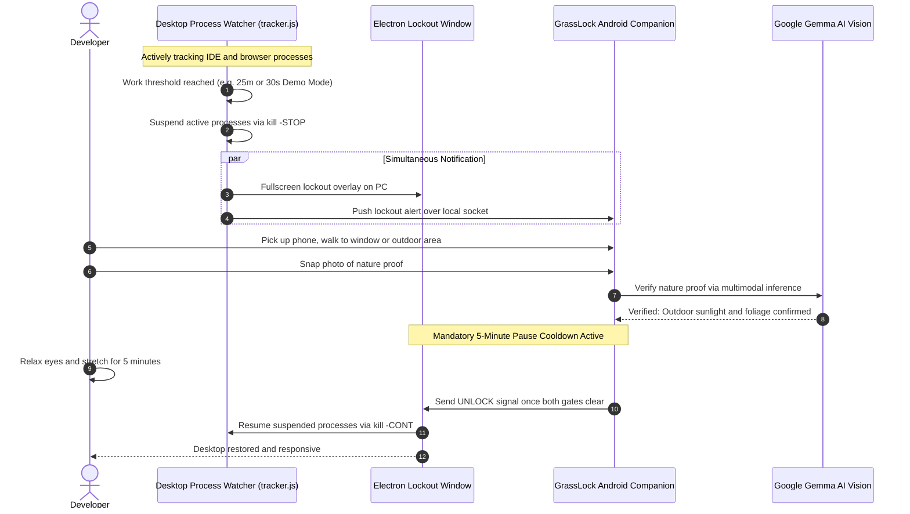

# GrassLock: Dual-Ecosystem Screen Sentinel

> **Hacktoberfest 2026 Week 1 Challenge: Touch Grass**  
> **Target Category:** **Best Use of Gemma ($200)** and **Overall Winner ($250)**  
> **Core AI:** Google Gemma Open-Weight Model (`gemma-4-26b-a4b-it`) via Google AI Studio

GrassLock is an anti-slop, dual-ecosystem screen guardian built specifically for developers experiencing screen fatigue. It continuously monitors active programming processes (`Antigravity IDE`, `VS Code`, `Firefox`, `Chrome`), triggers a strict desktop lockout with real process freezing (`kill -STOP`) when work limits are reached, and enforces a dual-gated recovery requirement:
1. Stepping away from the desk and snapping an authentic photo of outdoor nature (grass, sunlight, sky, foliage) verified by Google Gemma 4 AI.
2. Observing a mandatory 5-minute pause cooldown to ensure genuine cognitive rest before thawing processes (`kill -CONT`).

---

## The Experience: Desktop and Mobile Integration



---

## Key Features

### 1. Desktop Sentinel (`desktop/`)
* **Process Watcher**: Real-time detection and tracking of `antigravity`, `code` (VS Code), `firefox`, and `chrome` on Linux.
* **Real Process Freezing**: Freezes active target applications with `kill -STOP` upon lock, and thaws them with `kill -CONT` upon verified unlock.
* **Taste Skill Soft-Skill Design**: Built according to [tasteskill.dev](https://www.tasteskill.dev/) soft-skill principles: calm obsidian palette (`#0A0D0B`), double-bezel concentric cards, floating island header, spring motion physics, and offline Lucide icons with zero emojis.
* **Instant Demo Mode**: Includes a 30-second Demo Mode toggle so Hacktoberfest judges can test the full lock, notify, verify, cooldown, and thaw sequence in seconds.
* **Dual-Gated Lockout Overlay**: Covers the screen with an unignorable backdrop that displays live 5-minute break timers and verification state.

### 2. Android Mobile Companion (`android/`)
* **Native Jetpack Compose UI**: Fast, responsive obsidian dark interface matching the desktop soft-skill design language with Material vector icons and zero emojis.
* **Built-in Camera Viewfinder**: High-resolution camera capture (`ActivityResultContracts.TakePicturePreview`) for capturing instant proof of nature.
* **Dual-Connection Modes**: Connects over Wi-Fi LAN or direct USB (`127.0.0.1:3847` via `adb reverse tcp:3847 tcp:3847`).
* **Dual-Gate Cooldown Card**: Displays real-time breakdown of outdoor proof status and the 5-minute pause requirement before unlocking.

### 3. Open-Source AI Core: Google Gemma 4
* Analyzes captured photos with `gemma-4-26b-a4b-it` to confirm outdoor authenticity (grass, foliage, sky, natural illumination).
* Returns seasonal naturalist feedback to educate the developer about the outdoor environment.

---

## Quick Start and Local Setup

### Prerequisites
* **Node.js**: v18+ (Node v24 tested)
* **Android Device or Emulator**: Android 7.0+ (API 24+)
* **Google AI Studio API Key**: Key from [aistudio.google.com](https://aistudio.google.com/)

### 1. Setup Environment
In `week1/`, ensure `.env` contains:
```bash
GOOGLE_AI_KEY=your_google_ai_studio_api_key_here
```

### 2. Run Desktop Electron Sentinel

#### Option A: Run Directly (Development Mode)
```bash
cd desktop
npm install
npm start
```
The desktop app window opens immediately, monitors processes, and hosts the local bridge on port `3847`.

#### Option B: Compile / Pack Standalone Linux Executable Binary
```bash
cd desktop
npm run pack
```
This builds a standalone, self-contained binary at:
```bash
./dist/linux-unpacked/grasslock-desktop
```
Run it directly:
```bash
./dist/linux-unpacked/grasslock-desktop
```

#### Option C: Run Headless Server Only
```bash
cd desktop
node server.js
```
Open `http://localhost:3847` in your browser.

### 3. Run Android Mobile App
Open `android/` in Android Studio, or build and run via CLI:
```bash
cd android
./gradlew installDebug
```
For USB tethering, run:
```bash
adb reverse tcp:3847 tcp:3847
```
Launch the app on your phone, choose `USB Cable (127.0.0.1)` or `Wi-Fi LAN`, and pair instantly.

---

## Why Open Innovation Matters for "Touch Grass"

1. **Trail and Outdoor Resilience**: Outdoor applications should not break the moment cellular reception drops. Because Gemma is open-weight, model weights can run on local edge devices, laptops, or low-power hardware without depending on closed cloud servers.
2. **Location Privacy**: Outdoor enthusiasts and foragers should not have their private coordinates and photos mined by closed surveillance platforms. Open models keep environmental data under the user's control.
3. **Zero Cost and Open Access**: Anyone from independent developers to student hackers can build and run this without paying recurring subscription paywalls.

---

## Hacktoberfest 2026 Details
* **Challenge:** Week 1: Touch Grass (Oct 5 to Oct 11, 2026)
* **Categories Entered:** **Best Use of Gemma ($200)** and **Overall Winner ($250)**
* **License:** MIT
